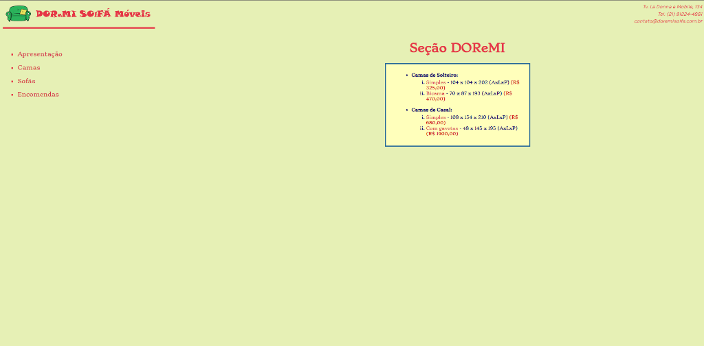
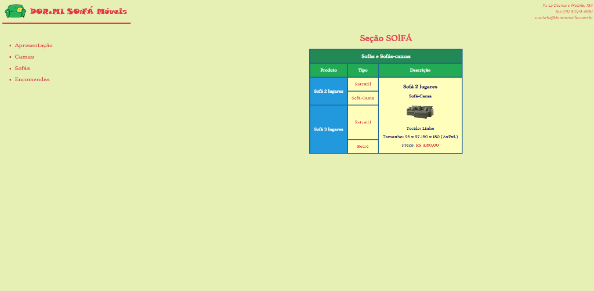
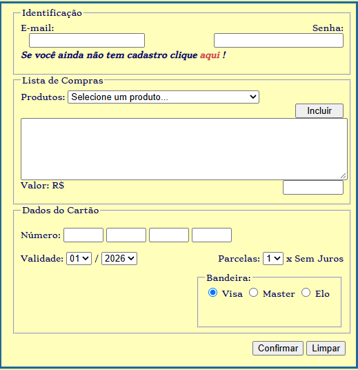

# DOReMI SOLFÁ Móveis

> **Versão 0.0 (Legado)** — Projeto acadêmico desenvolvido para a disciplina de **Construção de Página Web** do curso de **Tecnologia em Sistemas de Computação** da **Universidade Federal Fluminense (UFF)**.

---

## Sobre o Projeto

O **DOReMI SOLFÁ Móveis** é uma aplicação web fictícia para uma loja de móveis especializada em camas (Seção *DOReMI*) e sofás (Seção *SOLFÁ*). O projeto foi desenvolvido como parte das avaliações práticas (AD1 e AD2) da disciplina de Construção de Página Web, cobrindo os fundamentos essenciais da web: **HTML5 semântico, CSS3 e JavaScript puro (Vanilla JS)**.

Esta versão **0.0** representa o código original concluído para a entrega acadêmica e é preservada como o marco inicial de um processo de **modernização contínua**.

---

## Contexto e Objetivo no Portfólio

- **Origem Acadêmica:** Graduação em Tecnologia em Sistemas de Computação — UFF.
- **Próximo Passo:** Modernização do Front-End utilizando **React**, aplicando os conceitos abordados no Curso Técnico em Desenvolvimento de Sistemas do **SENAI**.

---

## Funcionalidades da Versão 0.0 (Legado)

- **Apresentação Institucional:** Página inicial estruturada com cabeçalho, navegação, dados de contato e identidade visual da marca.
- **Catálogo de Camas (Seção DOReMI):** Listagem de modelos de solteiro e casal com abertura dinâmica de detalhes e imagens em janela pop-up/modal via JavaScript.
- **Catálogo de Sofás (Seção SOLFÁ):** Tabela interativa com visualização detalhada sob demanda (dimensões, tecidos, tipos e preços) ao clicar em cada opção.
- **Módulo de Encomendas:** Montagem de lista de compras dinâmica através de `<select>`, adicionando itens e calculando o total acumulado em tempo real via JavaScript.
- **Módulo de Cadastro:** Formulário com múltiplos campos de dados pessoais/endereço e validação de consistência de senhas em JavaScript.

---

## Tecnologias Utilizadas (v0.0)

- **HTML5:** Estruturação semântica das páginas (`<header>`, `<nav>`, `<section>`, `<fieldset>`, `<address>`, etc.).
- **CSS3:** Estilização com layout baseado em caixas, formulários estilizados, tipografia personalizada e tabelas de dados.
- **JavaScript (Vanilla):**
  - Manipulação de DOM e escuta de eventos (`DOMContentLoaded`, `click`, `change`, `reset`).
  - Lógica de cálculo acumulativo de compras.
  - Validação de formulários e crítica de campos de senha.
  - Controle de pop-ups e exibição dinâmica de produtos.

---

## Estrutura de Arquivos

```text
Solfa/
├── docs/                             # Documentação acadêmica e imagens
│   ├── AD1_WEB_2026_2.pdf            # Enunciado da Avaliação a Distância 1
│   ├── AD2_WEB_2026-2.pdf            # Enunciado da Avaliação a Distância 2
│   └── screenshots/                  # Registros visuais da versão legada v0.0
│       ├── secao-doremi-camas.png
│       ├── secao-solfa-sofas.png
│       └── modulo-encomendas.png
├── imagens/                          # Ativos visuais originais (logos e produtos)
│   ├── DoremisofaLogo.png
│   ├── DoremisofaLogoTopo.png
│   └── ... (fotos de camas e sofás)
├── Cadastro.html                     # Formulário de cadastro de clientes
├── camas.html                        # Estrutura base da seção de camas
├── Doremi.html                       # Página do catálogo de camas
├── DoremisolfaMoveis.html            # Versão inicial da apresentação
├── DoremisolfaMoveisHTML5.html       # Apresentação institucional com HTML5 semântico
├── Encomendas.html                   # Página de orçamentos e pedidos com cálculo em JS
├── Solfa.html                        # Página do catálogo interativo de sofás
├── script.js                         # Regras de negócio, cálculos e validações em JS
├── style.css                         # Folha de estilos global
└── README.md                         # Contextualização do projeto e histórico
```

---

## Como Executar a Versão Legada

Como esta versão utiliza apenas tecnologias nativas do navegador, nenhuma instalação de dependências é necessária:

1. Clone ou baixe este repositório.
2. Abra qualquer um dos arquivos `.html` diretamente no seu navegador preferido (recomendado: `DoremisolfaMoveisHTML5.html`), ou:
3. Utilize a extensão **Live Server** no VS Code para uma melhor experiência de navegação local.

---

## Demonstração Visual (Screenshots da v0.0)

Abaixo estão os registros visuais da interface original desenvolvida na faculdade utilizando apenas HTML5 e CSS3 puros:

### 1. Seção DOReMI (Catálogo de Camas)
Estrutura da página com navegação lateral, cabeçalho institucional e listagem de modelos de solteiro e casal. Ao clicar em cada modelo, uma janela/modal é disparada via JavaScript exibindo foto e especificações técnicas.



---

### 2. Seção SOLFÁ (Catálogo Interativo de Sofás)
Tabela interativa construída com HTML5 e estilizada em CSS. Cada linha permite alternar a visualização central dinâmica com imagem, tecido, dimensões e valor em tempo real através de manipuladores de eventos em JavaScript puro.



---

### 3. Módulo de Encomendas (Carrinho & Pagamento)
Formulário de identificação, seleção de produtos via combobox com cálculo automático acumulado do orçamento em um campo de texto, e seção para inserção dos dados de pagamento e parcelamento.


