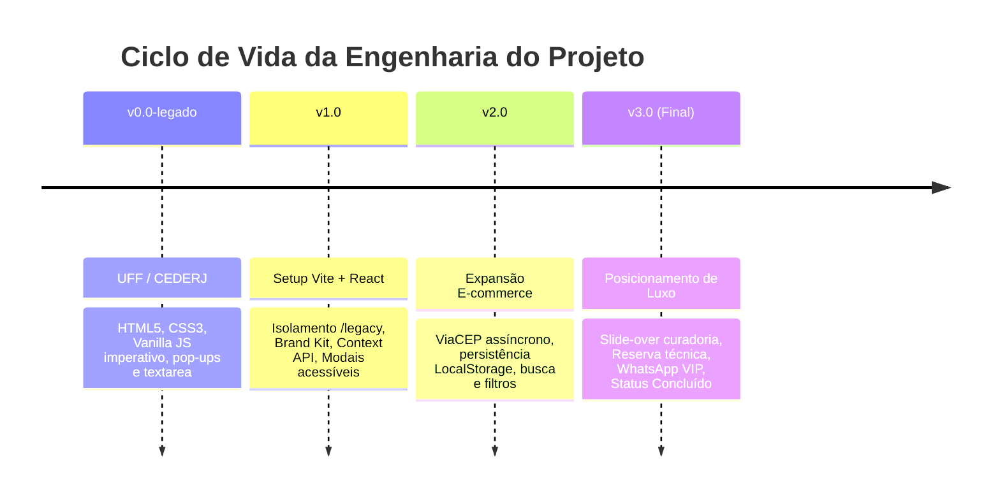
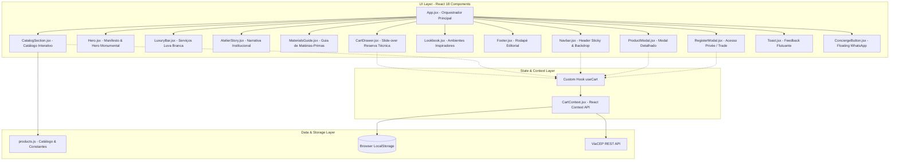

# Especificação Técnica de Software (SRS) — DOReMI SOLFÁ Móveis

| Metadado | Informação |
| :--- | :--- |
| **Projeto** | DOReMI SOLFÁ — Atelier de Mobiliário Autoral & E-Commerce |
| **Versão do Documento** | 3.0.0 (Final / Release Oficial) |
| **Status do Projeto** | **Concluído** |
| **Deploy em Produção** | [https://doremi-solfa.vercel.app/](https://doremi-solfa.vercel.app/) |
| **Autor** | Erique Guida |
| **Origem Acadêmica** | Universidade Federal Fluminense (UFF) / Fundação CECIERJ |
| **Aprimoramento Técnico** | SENAI — Técnico em Desenvolvimento de Sistemas |
| **Stack Principal** | React 18, Vite 6, Tailwind CSS 3, Lucide React, ViaCEP API, Vercel |
| **Engenharia Assistida** | Google Antigravity (Pair Programmer & Tech Lead Virtual) |

---

## 1. Visão Geral e Propósito

### 1.1 Objetivo do Projeto
O **DOReMI SOLFÁ** é uma aplicação web Single Page Application (SPA) para uma boutique e atelier fictício de mobiliário autoral de alto padrão. O projeto foi estruturado para demonstrar domínio sólido e prático sobre os fundamentos e as práticas modernas de desenvolvimento Front-End:
* Domínio de **HTML5 Semântico**, **CSS3 Avançado** e manipulação do DOM (preservados no histórico legado).
* Transição e refatoração para **React 18**, arquitetura componentizada e gerenciamento de estado declarativo.
* Implementação de **Design System** coeso com tokens semânticos e tipografia refinada.
* Consumo assíncrono de **APIs REST externas** (ViaCEP) com tratamento de estados de erro e carregamento.
* Persistência de dados local (**LocalStorage**) e regras de negócio de carrinho, frete e curadoria técnica.

### 1.2 Declaração de Escopo e Conclusão
O ciclo de vida planejado para o front-end deste projeto encontra-se **100% finalizado**, cumprindo todos os requisitos acadêmicos originais da UFF e expandindo-os para uma solução comercial de alto padrão visual e funcional.

Como o foco profissional do autor está direcionado para **Back-End e Engenharia de Software**, o escopo do projeto foi delimitado com precisão para comprovar a capacidade de construir e manter interfaces modernas sem inflar a infraestrutura desnecessariamente (dispensando frameworks SSR como Next.js, Redux ou suítes E2E pesadas).

### 1.3 Metodologia de Pair Programming com Google Antigravity
O desenvolvimento da modernização seguiu um ciclo rigoroso de engenharia assistida por inteligência artificial, utilizando o **Google Antigravity** como parceiro de pair programming. O processo operou sob condução ativa através de milestones planejados:
1. Auditoria e isolamento do código acadêmico original da UFF em `/legacy`.
2. Criação do Brand Kit e modelagem semântica dos dados mantendo o vínculo com os IDs acadêmicos (`legacyId`).
3. Reconstrução dos componentes e eliminação de débitos técnicos (`window.open` e `alert`).
4. Implementação de persistência e integração assíncrona ao ViaCEP.
5. Validação com compilação e bundling estático via Vite antes de cada avanço de milestone e tag Git.



---

## 2. Origem Histórica e Rastreabilidade

O projeto nasceu a partir das Avaliações a Distância 1 e 2 (AD1 e AD2) da disciplina de **Construção de Páginas Web** do curso Superior de Tecnologia em Sistemas de Computação da **UFF**:

1. **Requisitos Originais da UFF:**
   * Apresentação institucional da loja fictícia com 2 seções principais: **DOReMI (Camas)** e **SOLFÁ (Sofás)**.
   * Catálogo de 8 produtos pré-determinados:
     * 4 Camas: Solteiro Simples, Solteiro Bicama, Casal Simples, Casal com Gavetas.
     * 4 Sofás: 2 Lugares Retrátil, Sofá-Cama 2 Lugares, 3 Lugares Retrátil, 3 Lugares Retrô.
   * Janelas de detalhes com especificações de medidas e materiais.
   * Lista dinâmica de compras com cálculo acumulado.
   * Formulário de cadastro de clientes com validação de senhas.
2. **Preservação do Legado:**
   * Todo o código-fonte acadêmico original, folhas de estilo e scripts em Vanilla JS foram encapsulados no diretório [`/legacy`](legacy/README.md), sem alteração de sintaxe, permanecendo acessíveis para auditoria técnica.
   * Todos os 8 produtos modernos contêm a chave `legacyId` (`cama1`, `cama2`, `cama3`, `cama4`, `sofa1`, `sofa2`, `sofa3`, `sofa4`), mantendo 100% de rastreabilidade com o enunciado da faculdade.

---

## 3. Arquitetura de Software

### 3.1 Diagrama da Arquitetura SPA



### 3.2 Padrões de Projeto (Design Patterns) Adotados
* **Single Source of Truth (SSOT):** O estado de compras, endereço e opção de entrega é gerenciado de forma única através do `CartContext`.
* **Compound Component / Container-Presenter:** Separação entre componentes inteligentes de controle de estado (`CatalogSection`, `CartDrawer`) e componentes puramente visuais (`ProductCard`, `LuxuryBar`).
* **Custom Hook Pattern:** Encapsulamento de regras e exceções através de `useCart()`, impedindo o consumo indevido de contextos fora de sua árvore de cobertura.
* **Controlled Forms:** Formulários em `CartDrawer` e `RegisterModal` com estados controlados e máscaras síncronas de validação.

---

## 4. Especificação dos Módulos e Componentes

### 4.1 Cabeçalho & Navegação (`Navbar.jsx`)
* **Comportamento:** Posicionamento fixo (`sticky top-0 z-40`) com fundo translúcido em vidro jateado (`bg-[rgba(246,244,239,0.88)] backdrop-blur-[12px]`).
* **Elementos:**
  * Logotipo tipográfico institucional em alto kerning (*DOREMI SOLFÁ · Atelier de Mobiliário*).
  * Menu desktop com links institucionais (*O Atelier*, *Leitos*, *Estofados*, *Matérias-Primas*, *Lookbook*).
  * Gatilho de Acesso Privée com ícone vetorial.
  * Botão cápsula com contador reativo de itens (`Minha Seleção · X`).
  * Menu responsivo gaveta para dispositivos móveis com fechamento automático ao clique.

### 4.2 Hero & Manifesto (`Hero.jsx`)
* **Comportamento:** Apresentação da marca em grid responsivo assimétrico (manifesto editorial à esquerda e fotografia arquitetônica monumental em proporção 4:5 à direita).
* **CTAs:** Acesso direto ao catálogo de peças (`#catalogo`) e à narrativa do atelier (`#atelier`).

### 4.3 Seção do Atelier & Fazer Artesanal (`AtelierStory.jsx`)
* **Comportamento:** Detalhamento da filosofia da marca (marcenaria tradicional, encaixes sem parafusos aparentes, secagem natural de madeiras e acabamento manual com ceras nobres).

### 4.4 Guia Tátil de Matérias-Primas (`MaterialsGuide.jsx`)
* **Comportamento:** Painel explicativo dos tecidos puros (Linho Belga, Veludo de Algodão Esmeralda, Couro Natural, Suede Touch) e madeiras maciças sustentáveis (Freijó, Carvalho Americano, Nogueira).

### 4.5 Catálogo Dinâmico (`CatalogSection.jsx` e `ProductCard.jsx`)
* **Filtros por Coleção:** Chips clicáveis (*Todas as Peças*, *Leitos & Camas Plataforma*, *Daybeds & Marcenaria Nobre*, *Sofás Autorais & Modulares*, *Estofados em Veludo Esmeralda*).
* **Busca em Tempo Real:** Campo de texto livre com varredura em `nome`, `descricao`, `material`, `tecido`, `tipo`, `dimensoes` e sinônimos de categorias.
* **Ordenação:** Critérios por Destaque, Menor Preço, Maior Preço e Ordem Alfabética.
* **Sincronização com URL:** Listener de `window.location.hash` permitindo que links âncora externos (`#camas` ou `#sofas`) ativem automaticamente o filtro correspondente.
* **Card de Produto:** Formato edge-to-edge 4:3 com efeito de zoom hover, badge de categoria, dimensões, tecido, valor sob encomenda e gatilhos para modal de detalhes ou contato com concierge.

### 4.6 Janela de Detalhes (`ProductModal.jsx`)
* **Acessibilidade:** Suporte a tecla `Escape` e clique no backdrop para fechamento imediato.
* **Galeria de Fotos:** Exibição da foto principal e miniaturas selecionáveis de ângulos secundários do produto.
* **Ações:** Adição ao carrinho de compras com feedback visual flutuante e botão de consulta direta ao Concierge.

### 4.7 Slide-Over de Reserva Técnica (`CartDrawer.jsx`)
* **Substituição do Checkout Legado:** Elimina checkout de pagamento por cartão fictício e implementa o fluxo de **Curadoria e Reserva Técnica sob Encomenda**.
* **Gerenciamento de Itens:** Adição, decremento unitário e remoção de produtos, com subtotal calculado dinamicamente.
* **Consulta de Frete e Endereço:**
  * Campo de CEP com máscara `00000-000` e integração automática ao **ViaCEP**.
  * Seleção de modalidade: *Entrega Tradicional com Montagem Cortesia* (R$ 0,00) vs. *Entrega Agendada VIP com Montador Especialista* (R$ 120,00).
* **Geração de Protocolo:** Submissão do formulário gera um identificador exclusivo no formato `DS-YYYY-XXXX` (ex: `DS-2026-4891`).
* **Deep Link WhatsApp:** Botão para encaminhar os dados completos da reserva formatados diretamente para o WhatsApp do Concierge.

### 4.8 Acesso Privée & Acesso Trade (`RegisterModal.jsx`)
* **Finalidade:** Cadastro de clientes para relacionamento e especificação técnica.
* **Campos:** Nome Completo, E-mail, WhatsApp (com máscara automática) e Senha (com botão de alternância de visibilidade de senha).
* **Segmentação Trade:** Checkbox para arquitetos, designers de interiores e decoradores com acesso a condições diferenciadas.

### 4.9 Feedback Flutuante (`Toast.jsx`)
* **Comportamento:** Notificação temporária não-intrusiva posicionada no canto inferior direito com auto-dispensa após 3,5 segundos.

---

## 5. Modelagem de Dados e Armazenamento

### 5.1 Esquema da Entidade Produto (`Product`)
```javascript
{
  id: string,               // Identificador único contemporâneo (ex: 'cama-solteiro-simples')
  legacyId: string,         // Identificador original do trabalho UFF (ex: 'cama1')
  categoria: 'doremi' | 'solfa',
  nome: string,             // Nome comercial autoral
  tipo: string,             // Classificação da peça
  estilo: string,           // Diretriz de design
  dimensoes: string,        // Altura x Largura x Profundidade (cm)
  material: string,         // Madeira maciça ou estrutura
  tecido?: string,          // Revestimento têxtil (quando aplicável)
  preco: number,            // Valor unitário sob encomenda (BRL)
  imagem: string,           // Imagem principal em alta definição
  galeria: string[],        // Array de URLs fotográficas complementares
  descricao: string,        // Texto editorial de apresentação
  destaque: boolean,        // Flag de prioridade visual
  disponivel: boolean       // Disponibilidade para produção
}
```

### 5.2 Estrutura do Estado no LocalStorage
| Chave | Tipo | Descrição |
| :--- | :--- | :--- |
| `doremi_solfa_cart_v2` | `Array<{ product: Product, quantity: number }>` | Lista de itens persistida no carrinho. |
| `doremi_solfa_address_v2` | `Object` | Dados de CEP, logradouro, bairro, cidade e UF obtidos via ViaCEP. |
| `doremi_solfa_delivery_v2` | `'traditional' \| 'vip'` | Modalidade de frete selecionada. |

---

## 6. Integrações com Serviços Externos

### 6.1 API do ViaCEP
* **Endpoint:** `GET https://viacep.com.br/ws/{cep}/json/`
* **Fluxo de Tratamento:**
  1. Sanitização do input: remoção de caracteres não-numéricos (`cleanCep.length === 8`).
  2. Ativação de flag `isCepLoading = true`.
  3. Verificação de erro retornado pela API (`data.erro === true`).
  4. Preenchimento reativo de logradouro, bairro, localidade e UF no estado.
  5. Fallback seguro: se a requisição falhar por conectividade, os campos permanecem editáveis manualmente pelo usuário.

### 6.2 Deep Link WhatsApp Concierge
* **Endpoint:** `https://wa.me/5521912244881?text={mensagem_codificada}`
* **Conteúdo:** Mensagem estruturada em Markdown com Protocolo, Dados do Cliente, Finalidade da Peça, Resumo de Itens e Subtotal Formatado.

---

## 7. Design System & Identidade Visual

### 7.1 Paleta de Cores Semântica
```css
/* Paleta Oficial — DOReMI SOLFÁ */
--brand-primary:      #1F563E; /* Verde-Floresta (Navbar e Ações Principais) */
--brand-highlight:    #B34229; /* Terracota (Destaques, Badges e Preços) */
--brand-accent:       #DFA034; /* Mostarda (Acentos e Detalhes de Acabamento) */
--brand-bg:           #FAF8F5; /* Off-White Suave (Superfície Principal de Fundo) */
--brand-surface:      #FFFFFF; /* Branco Puro (Cards, Modais e Drawers) */
--brand-muted:        #F3EFEA; /* Areia Neutro (Seções secundárias) */
--brand-border:       #E8E4DC; /* Borda Suave */
--brand-dark:         #1C2521; /* Carvão Escuro (Texto de Alto Contraste) */
--brand-textMuted:    #64746D; /* Cinza Médio Natural (Subtítulos e Metadados) */
```

### 7.2 Tipografia Oficial
* **Títulos & Expressões Editoriais:** `Cormorant Garamond` (Google Fonts, pesos 300, 400, 500, 600, 700).
* **Interface & Textos Funcionais:** `Plus Jakarta Sans` (Google Fonts, pesos 400, 500, 600, 700).

---

## 8. Guia de Instalação, Execução e Build

### 8.1 Requisitos de Ambiente
* Node.js `>= 18.0.0`
* NPM `>= 9.0.0`

### 8.2 Comandos Operacionais
```bash
# Instalação das dependências
npm install

# Inicialização do servidor de desenvolvimento com HMR
npm run dev

# Compilação e bundling estático para produção
npm run build

# Execução local do bundle gerado em /dist
npm run preview
```
